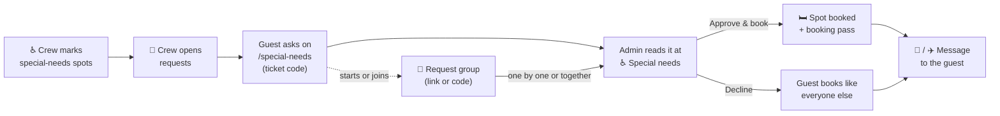
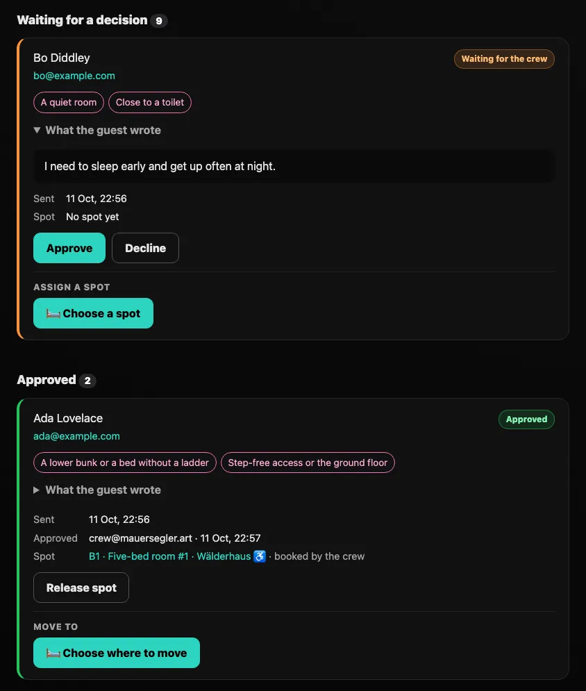
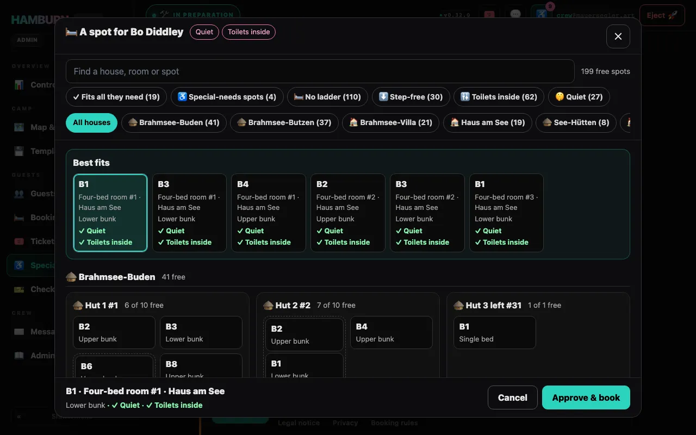
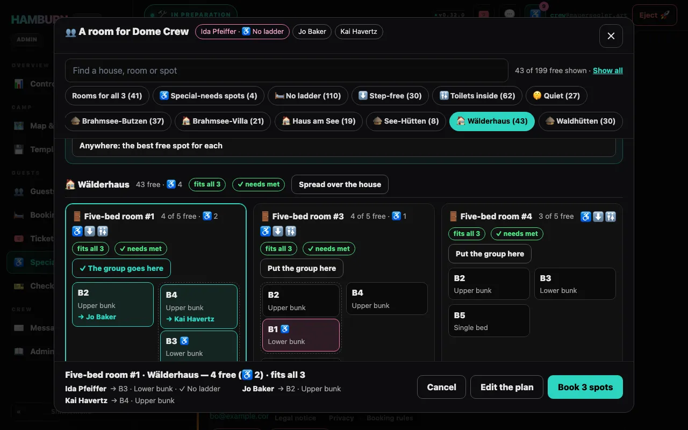

# Special-needs requests

Some guests need a particular kind of spot for a medical reason or a disability: a lower bunk, step-free access, a place close to a toilet, a quiet area, stable light, or something else; whoever comes along as their helper asks too. An art project or a crew may need a room, or a bed close to its piece. All of them **ask the crew with their ticket code, even before booking opens**, with the same form, on their own or **as a group**. Admins read each request, approve or decline it, and **book a spot for the guest** — the only way a spot gets booked while booking is closed, and the only way anyone gets a ♿ spot.

## At a glance

## 1. Mark special-needs spots

On a room page, <kbd>♿ SPECIAL</kbd> marks a spot as a special-needs spot; <kbd>♿ NORMAL</kbd> turns it back into a normal one. Works in Staging Mode, during Live Booking and after booking closed: **♿ is how you hold spots for requests, in every phase.** 🔄 TAKEN and deactivating don't — they take a spot out of the picker too, and the layout lock allows them only in Staging Mode.

- **Nobody books it on the guest pages**, not even with a crew ticket. Guests see it like a locked spot, as *Blocked by admin* (violet, with *Not available* under it), and never learn why; a booking sent anyway is refused by the server (*This spot is not available.*). Once a guest has it, it shows as an ordinary occupied spot with their burner name: nobody can tell who has special needs.
- **Only the crew books it**, here on the requests page: for one request, or for the members of a group. That is the difference to 🔒 *locked* (a broken or out-of-service bed): on the room page a locked spot can still be booked with a crew ticket, one whose e-mail is that of an approved admin or superuser, never a ♿ one.
- **It never counts as free on the guest pages**, like a locked spot.
- **It is the pool for every request:** a personal need, a helper, an art project or a crew, a member of a group. The [spot picker](#the-spot-picker) shows it in pink and puts it first among the *Best fits*; the [group planner](#groups) recommends the rooms whose free ♿ spots take most of the group and fills those first, the fitting ones for the members with a personal need.
- **Templates keep it** (`"is_special": true` on the spot, see [Layout templates](./templates#file-format)).

Mark the spots before booking opens; more can follow in any phase. Special-needs spots that nobody needs at the end: switch them back to <kbd>♿ NORMAL</kbd> one by one, and guests can book them. The feature *♿ Wheelchair accessible* of a house or room is something else: it describes the place for guests and keeps no spot free.

**♿ Special-needs spots** — the box right above the requests on ♿ **Special needs** — shows what became of the marked spots, e.g. *2 free · 3 booked through requests · 1 booked otherwise · 1 blocked with TAKEN · 1 locked 🔒* (parts with nothing in them are left out, except *free*). <kbd>Show all 7</kbd> lists every marked spot with a link to its room page and its state:

| State | Means | What to do |
| --- | --- | --- |
| *free* | Offered for requests, ahead of every other free spot. | – |
| *booked for … through their request* | The crew booked it for that guest's request. | – |
| *booked by …, not through a request — it counts again once it is free: on their request's card, Choose where to move (or Release spot, once approved) frees it in every phase*, with <kbd>Their request ↓</kbd> | A guest held it before it was marked ♿, and they have a waiting or approved request. | Leave it, or move the guest on their card (once approved, <kbd>Release spot</kbd> works too) — in every phase. |
| *booked by …, not through a request — it counts again once it is free; the room page releases it only in Staging Mode* | A guest without a request held it before it was marked ♿, or their request was withdrawn or declined and the spot stayed as an ordinary booking. | Leave it — during Live Booking the guest can still release it themselves. The room page frees it only in Staging Mode. |
| *blocked with TAKEN — not offered; TAKEN can only be cleared in Staging Mode* | Marked 🔄 TAKEN without a ticket. | Free it on the room page in Staging Mode. |
| *locked 🔒, out of service — not offered; an admin can still book it on purpose, or unlock it on the room page* | Also locked 🔒: a broken or out-of-service bed. The planner never uses it, and nothing counts it as free. | Unlock it on the room page once it is usable again — that works in every phase. Or book it on purpose: the picker and the dialog warn first. |
| *inactive — not offered; it can only be activated in Staging Mode* | Deactivated. | Activate it in Staging Mode. |

Only *free* spots count for requests; a locked one stays in the picker for a deliberate pick. With nothing marked yet, the box says *No spot is marked ♿ yet. Mark spots with ♿ SPECIAL on the room pages: no guest can book them, and they are offered first here.*

::: tip Fill in the details first
Which spot fits which need comes from the layout: the **bed type** of a spot and the **features** of its room and house (see [Houses, rooms & spots](./camp-layout#house-details)). A lower bunk in a step-free room with toilets in the building is what a request asking for all three needs; stacked [bunk beds](./camp-layout#bunk-beds) mark their lower and upper level by themselves. Spots nobody described can still be assigned — the picker just can't tell you what they answer. What an art project or a crew asks for — a room, or a bed close to its piece — is yours to match: the [group planner](#groups) helps with that.
:::

## 2. Open requests

Requests have their **own switch**, independent of Staging Mode and Live Booking: <kbd>Open requests</kbd> / <kbd>Close requests</kbd> in the row *♿ Special-needs requests: OPEN / CLOSED* right under the [🎟 BOOKING WINDOW](./#booking-window) panel in the Control Center, or the same button on the requests page (*Requests from guests: OPEN*).

- **Open:** guests see a link on the map and can send a request, change it while it waits, and start or join a group. Before booking opens the link reads *♿ Special needs or a project? Ask the crew now*; during Live Booking and after it, it is the link *♿ Special-needs spot* in the top bar of every booking page.
- **Closed:** no new requests, no changes, and nobody starts or joins a group. Waiting requests stay; guests still see theirs (the map link then reads *♿ See your special-needs request* or *♿ My request*), can withdraw it and can leave their group. You still decide, book and take members out of groups.

Every switch goes to the crew group with the admin's e-mail address.

## 3. Decide and book

<kbd>♿ Special needs</kbd> in the admin menu, with the number of requests waiting for a decision. On top, the [♿ Special-needs spots](#_1-mark-special-needs-spots) box and the [groups](#groups); below them the requests, grouped into *Waiting for a decision*, *Approved* and *Declined*.

Each request shows:

- the **ticket holder** from the ticket list (name and e-mail address), when it was sent and changed;
- what the guest **chose**, **ticked** and **wrote** (5 to 500 characters), and a burner name if they chose one. The form has three paths, and a request holds the boxes of one of them (see [Asking for a spot](../guide/special-needs#asking-for-a-spot)):
  - **a personal need** (a medical reason or a disability) — a lower bunk or a bed without a ladder · step-free access or the ground floor · close to a toilet · a quiet area · stable light conditions · something else — each a pink pill. The guest writes *what* they need, never *why*;
  - **the helper** of someone with a personal need: nothing to tick, and always sent from a group, so the group's card shows whom they came with. They write what the crew should know, like sleeping in the same room or close by. A helper gets a ♿ spot like anyone in the group, after the members with a personal need;
  - **an art project or a crew** — 🎨 a room for our art project or crew · a bed close to our art piece or project — each a neutral outlined pill, because pink stays ♿ only. Their text has at least 5 words: what they need and why the art piece or project would be at risk without it.

  A guest who asks only as part of a group may choose nothing, tick nothing and write nothing: the card then says *👥 Group only: nothing of their own*. Older requests can still show values the form no longer offers: *Spots close to the people I come with (old form)* from before the three paths, and *A power socket for a medical device (old form)* from before v0.30.0;
- the **group**, if the request is in one: the chip *👥 group name* jumps to the group's card;
- who **decided** and when, and the **spot** the ticket holds right now: *booked by the crew* (through this page) or *booked by the guest*.

If a guest sends the form again right when you decide, the card says so: read it once more. Cards are colour-coded: **waiting** orange, **approved** green, **declined** grey and dimmed. On decided cards, what the guest wrote is folded away under *What the guest wrote*.

The [guest list](./guests) shows for every ticket only *where* a request stands — ♿ *request waits for a decision*, *request approved*, *request declined*, and ♿ *assigned through a request* on the spot — with <kbd>Requests →</kbd> leading here. Reading and deciding happens on this page.

| Button | What happens |
| --- | --- |
| <kbd>Approve</kbd> | The request is approved. A guest without a spot hears that the crew picks one; a guest who booked a spot themselves hears they keep it until you book a more fitting one. |
| <kbd>🛏️ Choose a spot</kbd> → <kbd>Approve & book</kbd> · <kbd>Book</kbd> | Opens the [spot picker](#the-spot-picker): tap a free spot and press the button at its bottom to book it for the guest, right away, also in Staging Mode and after booking closed. The dialog *Book this spot for the guest?* asks first; for a spot the crew locked 🔒 it asks *Book a blocked spot?* with *🔒 … is blocked (out of service). Book it anyway?*, and for a spot that clearly misses something the guest asked for it adds *✗ It doesn't answer what they asked for: No ladder.* A locked spot is booked only when that dialog warned about it: one the crew locked after your page loaded is refused (*🔒 … is blocked (out of service) now. Reload the page and pick again, or confirm it.*). A waiting request is approved on the way. The guest gets a message with the spot and the booking pass. Cancel the dialog and the card keeps the spot you picked, with <kbd>Approve & book</kbd> (or <kbd>Book</kbd>) to try again and <kbd>Change</kbd> to pick another one. |
| <kbd>🛏️ Choose where to move</kbd> → <kbd>Move here</kbd> | The same for a guest who already holds a spot: the picker shows it as *Now: …*, and the dialog *Move the guest?* says which spot becomes free. |
| <kbd>Release spot</kbd> | The spot becomes free again (a special-needs spot stays one); the request stays approved, so book another one. The guest gets a message. Also offered for a spot the guest booked themselves: the dialog warns that releasing takes it away from them. |
| <kbd>Decline</kbd> | The guest gets a message that the crew can't offer a special-needs spot: they keep a spot they booked themselves, or book like everyone else once booking opens. To decline a request whose spot you booked, release the spot first. |
| <kbd>⋯</kbd> → <kbd>Approve after all</kbd> | On a declined card only, deliberately out of the way (a declined card has no other buttons): the request is approved after all (the guest gets the *approved* message), and <kbd>🛏️ Choose a spot</kbd> comes back so you can book one. |

With no free spot left, <kbd>🛏️ Choose a spot</kbd> is greyed out and the card says *No free spot left. During Live Booking and after it, only a superuser in Staging Mode can free or add one; hold spots for requests in time with ♿ SPECIAL in the room editor (that works in every phase, TAKEN and deactivating don't).*

### The spot picker

One sheet over the page with every free spot of the camp, house by house and room by room, so you see where you put someone instead of reading a list. On a phone it fills the screen; when a group's names on top and its plan at the bottom leave the spots too little room, the whole sheet scrolls.

- **On top:** whom the spot is for and what they ticked (pink for something they need, outlined for a helper or a project wish), *Now: …* when they hold a spot already, and why no ♿ spot is free, if none is: *♿ No special-needs spot is free right now: 3 marked — 1 booked by a guest, 1 blocked with TAKEN, 1 inactive.* (the [♿ box](#_1-mark-special-needs-spots) lists them all).
- **Narrow it down:** a search for houses, rooms and spots (*walder 5* finds the rooms 5 of the Wälderhaus; case and accents don't matter), and chips that each show how many free spots they leave: *✓ Fits all they need* (only spots that answer everything the layout can tell of this request), *♿ Special-needs spots*, the wishes guests know from the map — *No ladder*, *Step-free*, *Toilets inside*, *Heated*, *Quiet*, only those some free spot answers — and one chip per house with a free spot. A locked 🔒 spot counts for no chip: a house with only locked spots has no chip, and its spots stay under *All houses*. Chips add up; *Show all* next to the search clears them. A row of chips takes at most about two lines, so the spots below always keep their room: with many houses, the rest of the row scrolls inside it (the half line at its bottom shows there are more). On a phone, and on a short laptop screen, each row is a single line that scrolls sideways.
- **Best fits:** up to six spots that clash with nothing in the request: the free ♿ spots first — they are the pool for every request, also a helper's, a project's or a group member's — then the spots that answer most of it. A request only a person can match (a project, a helper, a group only) gets the ♿ spots alone, and no strip when none is free.
- **The camp:** each house with its free spots (*41 free · ♿ 2*), each room as a card with *3 of 6 free*, its ♿ spots, *🔒 1 blocked* and the icons of what it offers (♿ ⬇️ 🚻 🔥 🤫), and each free spot as a tile: its name, its bed, ♿ in pink for a special-needs spot, a dashed violet edge with *Blocked (out of service)* for one the crew locked 🔒, and what it answers of **this** request — `✓ No ladder`, `✓ Step-free`; `✗` marks a clear mismatch, like an upper bunk for someone who needs a lower one, and such a tile is dimmed. A bunk bed whose two levels are both free is one tile with the upper level above the lower one. An upper bunk is never *step-free*, not even on the ground floor of a ♿ house — the ladder is a step. *Stable light conditions*, *something else*, the helper, the project wishes and the old *power socket* get neither `✓` nor `✗`: nothing in the layout answers them, so read what the guest wrote and pick by hand. A feature the crew switched off for one room or spot (*off here* in the [room editor](./camp-layout#room-details)) no longer counts for that spot. Deactivated and taken spots never appear.
- **At the bottom:** the spot you tapped with what it answers, *Cancel*, and the button that takes it — <kbd>Approve & book</kbd>, <kbd>Book</kbd> or <kbd>Move here</kbd> on a request's card, <kbd>Use this spot</kbd> in a group's plan. Picking a locked spot says *🔒 B3 is blocked (out of service). Book it anyway?*, and the dialog asks the same before anything is booked.

<kbd>Esc</kbd>, ✕, *Cancel* or a tap next to the sheet close it without a change. A spot the crew locked 🔒 is out of service: it is never among the *Best fits*, no count above counts it as free, and it stays in its room for when you pick it on purpose. Without JavaScript, each card shows a plain list of the free spots instead: the ♿ spots first, the best fits first within each part, a locked spot last with *🔒 blocked*. There is no dialog then: tick *Book a 🔒 blocked spot (out of service) anyway* under the list to book a locked one, otherwise the server refuses it.

### Groups

Guests who ask together share a **request group**: one of them starts it on the request form and shares its link or code, the others join with their own ticket code (see [Asking as a group](../guide/special-needs#asking-as-a-group)). Every member keeps their own request with its own status; the group itself has no status. Decide and book for the whole group on its card, or for each guest on their own card below — both work, and they mix.

The section **Groups 👥** sits above *Waiting for a decision*, one card per group:

- **The header:** *👥 name*, *4 of 5 · code ABCD-EF23 · started …*, and chips for what is in it: *2 waiting*, *1 approved*, *1 declined*, *1 booked by the crew*, ♿ *2 with something they need* (pink, only when someone ticked a need) and 🎨 *project* (when someone asked for a room or a bed for an art project or a crew). The card's left edge is orange while someone waits, green when someone is approved and nobody waits, grey otherwise.
- **The members:** the name from the ticket list (or *Ticket without a name*) · 🔥 the burner name, the status, the spot (*booked by the crew* or *booked by the guest*) or *No spot yet*, <kbd>Details ↓</kbd> to the member's own card, and <kbd>⋯</kbd> → <kbd>Take out of group</kbd>.

| Button | What happens |
| --- | --- |
| <kbd>Approve all waiting (2)</kbd> | Every waiting member is approved; each guest gets their own *approved* message. Members you already decided stay as they are. Then book their spots with the planner, or one by one. |
| <kbd>Decline group</kbd> | Every waiting member, and every approved one without a spot the crew booked, is declined; each guest gets the *declined* message. Members whose spot the crew booked stay approved and are counted in the dialog: release their spot first. |
| <kbd>🏠 Choose a room for the group</kbd> | Opens the spot picker for the whole group: a group sleeps in one room, and one that fits everyone books in one go (below). |
| <kbd>Book 4 spots</kbd> | Books the spots of the plan (below). |
| <kbd>⋯</kbd> → <kbd>Take out of group</kbd> | The request stays as it is, without the group. The guest sees that on their request page and gets no message. Their ticket can't join this group again, not even with its code — also not after withdrawing and sending a new request: the form says *You can't join this group. Please contact the crew.* |

Each button asks first, and the group buttons only touch open requests. **Book spots for the group** is the planner at the bottom of the card. **A group sleeps in one room**: only when no room has space for everyone does it get split, and then you pick the spots. So the planner only ever recommends a room, *Plan: Room 2 · Wälderhaus — 6 free (♿ 2) · fits all 5*: of the rooms that fit everyone, the one whose free ♿ spots take most of the group — the ♿ spots are the pool for special-needs requests, helpers and projects included — then the one that gives every member what the layout can tell of their needs, then the snuggest. A spot the crew locked 🔒 counts for nothing: a room fits with its other free spots, or not at all. In that room the plan fills the ♿ spots first. Members whose needs the layout can check choose first (no ladder, step-free, close to a toilet, quiet), then the other personal needs, then everyone else; then the plan repairs what that order got wrong: a member with a spot that clearly doesn't fit moves to a free one or swaps with another member when that removes the mismatch, and two members swap when that answers more needs without taking a ♿ spot out of use. Among the ♿ spots, members with a personal need come first. A locked spot is never planned. When no room has space for everyone, there is no plan: the line says *No room has 5 free spots together: pick a spot for each with Change.*, and every row starts on *Keep as is*. When the crew booked some members already, the rest joins them: the plan takes the room they sleep in (it also comes first in the picker); when that room has no space for the rest, there is no plan either, and the line says so: *The room where Ada sleeps has no space for all 3 others (2 free): choose a room for the rest, or pick each with Change.* — or *… is full: …* when it has no free spot at all.

**Put the group into one room, in one go:** <kbd>🏠 Choose a room for the group</kbd> opens the [spot picker](#the-spot-picker) for the whole group. On top, who gets a spot (with what they need) and who keeps a spot the crew booked. *Rooms for all 5* offers the three best rooms that fit everyone — the most ♿ spots for the group first, then those where the plan answers every member's needs — with *✓ needs met* or *needs: 1 of 2 met* under each. That is only a suggestion: every room that fits keeps its <kbd>Put the group here</kbd>. When no room has space for everyone, an orange line says so instead; when the rooms exist but your search or chips hide them, a line says *The filter hides the rooms for all 5 ·* with *Show all*. Every room card says *fits all 5* (green) or *too small for 5*, *♿ 2 of 5* (pink) when its free ♿ spots take two of the group, and *✓ needs met* or *needs: 1 of 2 met* where everyone fits; locked spots never count towards *fits*. The chip *Rooms for all 5* hides the rest. A room where other guests booked spots works too, and nobody is moved: the bottom line says *ℹ️ 2 spots in this room are already booked by other guests. Nobody is moved.* <kbd>Put the group here</kbd> writes each member's name on the spot the plan gives them and lists who goes where at the bottom, with what each spot answers of theirs. On a room that is too small the button reads <kbd>Put 3 of 5 here</kbd>: it places as many as fit and says *→ no spot left here* for the others — pick their spots afterwards with <kbd>Change</kbd>; nothing splits a group by itself. A room whose free spots are all locked has no button and no badge, only *Only 🔒 blocked spots here — pick one by hand with Change.* Then:

- <kbd>Book 5 spots</kbd> books the plan right away: the dialog asks *Book 5 spots in Room 2 · Wälderhaus?* (or *… for the group?* when the spots are in several rooms), names who gets which spot, and says when other guests sleep in the room.
- <kbd>Edit the plan</kbd> takes the plan into the card, to change single rows first.

**One row per member:** *→ B1 · Room 2 · Wälderhaus · ✓ No ladder* with <kbd>Change</kbd> and <kbd>✕</kbd>. <kbd>Change</kbd> opens the spot picker for that member alone; the spots of the other members carry their names (*→ Bo*), and picking one of them swaps the two — or, when this row had no spot, the other member goes back to *Keep as is* (the picker says *Planned for Bo, who loses it and goes back to Keep as is.* before you take it). A locked spot — only ever picked by hand — shows 🔒 in its row. <kbd>✕</kbd> sets the row back to *Keep as is*. A member whose spot the crew already booked shows *Keeps … (booked by the crew)* and stays there unless you pick another spot for them; a declined member shows *Declined — not booked.* Once you change a row, the plan line says *· changed by hand*. When everyone not declined already has a spot the crew booked, the planner says so and has no button. Without JavaScript, each row is a plain list of the free spots, starting with *Keep as is*, filled with the plan.

<kbd>Book 4 spots</kbd> (the number of rows with a spot) asks first and lists who gets which spot — *(✗ No ladder)* after a spot that clearly misses something the member asked for, 🔒 after a locked one; with a locked one the dialog asks *Book 4 spots …, 1 of them blocked?*, says *🔒 … is blocked (out of service). Book it anyway?* and its button reads <kbd>Book them anyway</kbd>; the server books a locked spot only when the dialog warned about it, and without JavaScript only with the box *Book 🔒 blocked spots (out of service) anyway* ticked — then other guests who sleep in a room the group goes to (*ℹ️ 2 spots in Room 2 · Wälderhaus are already booked by other guests; nobody is moved.*), how many move from a spot they booked themselves, how many waiting requests are approved on the way, and who gets no spot this time (*Keep as is*); it says so when booking is closed. Each guest gets their own message with the booking pass. Rows left on *Keep as is* don't change.

Before anything is booked, the server checks every picked spot once more. A spot taken meanwhile, two members on one spot, a member who left the group or a declined member stop the whole booking, and nothing is booked (see [When something doesn't work](#when-something-doesn-t-work)). Then it books member by member, like <kbd>Book</kbd> on each card, so those spots are fixed like any spot the crew booked. If one fails on the way — a request withdrawn, a spot taken in the very last second — the others stay booked and a warning says *3 of 4 spots booked. Not booked: …* with the name and the reason: book the rest on their own cards.

### What the open requests need

Above the requests, a box compares what the waiting requests (and approved ones without a spot) ticked with the free spots that fit:

> **What the open requests need**
> ♿ Special-needs spots — 3 free for 5 open requests ⚠️ not enough
> A lower bunk or a bed without a ladder — 4 asked · 6 free spots fit
> Step-free access or the ground floor — 2 asked · 1 free spot fits ⚠️ not enough

The first line counts the free ♿ spots (none the crew locked 🔒) against every open request: they are the pool for all of them, helpers, projects and group members included. ⚠️ means the camp has fewer fitting spots than requests: free one, mark more spots ♿, or fill in missing details in the room editor. *Stable light conditions*, *something else*, the helper, the project wishes and the old *spots close to the people I come with* and *power socket* get no line of their own — only a person can answer those. The per-need lines only see what the crew described, so a camp without details shows none of them.

Every decision and booking is in the audit log and goes to the crew group — **without the guest's name, what they wrote, the group's name or its code**. A group step is one line with counts, like *✅ Request group approved by …: 4 request(s)*; a new request that started or joined a group says so in its line. Joining or leaving with a request that already exists is not reported. All lines: [Crew group](./notifications#crew-group).

## What guests get

| When | Message (e-mail and, if connected, Telegram) |
| --- | --- |
| The request arrives | **We got your special-needs request**, with a link to see, change or withdraw it |
| Approved, no spot yet | **Your special-needs request was approved** — the crew picks a spot (or: they keep the spot they booked until you book a better one) |
| Approved and booked | **Your special-needs spot:** house, room, spot and the [booking pass](./passes), when approval and booking go out together. A spot you book after the *approved* message went out comes as **Your CozyNights spot:**, with the line *The crew picked this spot for you, so please contact the crew to change it.* |
| Declined | **About your special-needs request** — book like everyone else when booking opens |

Messages say what the crew decided, never what the guest wrote. A project request gets the same messages. Groups bring no messages of their own: a group step writes each member's own request, so each guest gets the message above about their own request, never about anyone else in the group. Starting or joining with an existing request, leaving, and being taken out of a group send nothing. On `/special-needs` the guest sees the status, what they sent, the spot and the pass, their group, and can connect Telegram. The wording of every message can be changed on <kbd>✉️ Messages</kbd> (see [Message texts](./notifications#message-texts)).

## Rules the app keeps

- **One request per ticket**, taken from the guest's signed-in ticket code, never from the form. The database refuses a second one. **A ticket is in at most one group**: to switch, the guest leaves theirs first.
- **A guest can change a request while it waits** and requests are open, and **withdraw it at any time**. Once you decided, the request is fixed: a guest who sends the form again reads *The crew has already decided on your request, so it can't be changed anymore. If something changed, please contact the crew.* and sees your decision. Withdrawing deletes it (and takes the guest out of their group); a spot the crew already booked stays booked, but from then on it is an ordinary booking (the guest can change it, and clear all bookings frees it). The crew group hears about every withdrawal.
- **One path per request.** The guest chooses what the request is about — a personal need, the helper of someone with one, or an art project or a crew — and the server keeps only the boxes of that path: boxes of another path that a browser without JavaScript sends along are dropped, and so is a value the form no longer offers. When every ticked box belongs to another path, the form refuses instead and names them (*You ticked “A quiet area” under another choice: …*), also for a guest in a group, so nothing the guest ticked disappears without a word. Every path needs 5 to 500 characters of text; an art project or a crew needs at least 5 words. A request from before the paths that ticked a personal need and a project wish both opens on the personal path when the guest changes it, so what they need to sleep well is never dropped by accident; the form names what the other path asked for and suggests telling the crew in the text.
- **A helper asks from a group.** The helper path is refused unless the guest starts a group, joins one or is in one already: *A helper asks together with the person they help: join their group, or start one and share the link.*
- **At most 5 people in a group** (12 until October 2026). The 6th reads *This group is full: a group can have at most 5 people. Please contact the crew.* The requests and groups made before v1.32.2 were all test data and were deleted with that update (`pb_migrations/1760900000_clear_request_groups.js` and `1760910000_clear_special_requests.js`, without a message to anyone); a spot the crew had booked for one of them stayed as an ordinary booking of its ticket. Should a group ever have more than 5 people, its card says *7 people, more than the 5 a group may have*: split it with <kbd>⋯</kbd> → <kbd>Take out of group</kbd>.
- **Starting or joining a group** only works while requests are open, with a new request or one that still waits for a decision. A guest whose request you already decided can't join a group anymore; the invite tells them to contact the crew.
- **Joiners may choose nothing, tick nothing and write nothing**, since the one who started the group described it. A joiner who chooses a path but ticks nothing on it still asks only as part of the group (a chosen radio can't be unchosen); the words are optional as long as nothing is ticked, and a helper always writes a few. A guest already in a group may send the same way. Whoever starts a group fills in the form like anyone asking alone.
- **Leaving works at any time**, also while requests are closed, like withdrawing. A request with nothing ticked is deleted when the guest leaves (a spot the crew booked stays as an ordinary booking); one with needs of its own stays as it is, with its status and spot.
- **A group without members is gone.** PocketBase deletes a group as soon as its last request leaves it, whichever way: leaving, withdrawing, a hand-over, a deleted ticket, `forget-contacts`. A deleted group can't come back; someone starts a new one.
- **Ten sends per hour.** A ticket can send or change its request at most ten times within an hour; after that the form says *You sent your request 10 times within an hour. Please wait a while, then try again.* On top of that, **five wrong group codes** within 15 minutes pause joining: *Too many wrong group codes. Please wait 15 minutes, then try again.*
- **Consent is given with every send.** The checkbox is unticked each time the form opens, and the stored consent time is the time of the last send.
- **A spot the crew booked is fixed.** The guest can give it a new burner name during Live Booking, but can't move or release it themselves: they ask the crew. You move or release it here. A spot the guest booked themselves stays theirs to change, also when the request is approved.
- **The burner name from the request** is used for the spot you book, unless the ticket already has one.
- **Going back to Staging Mode (and Clear all bookings) keeps the spots the crew booked**, with their burner names; every other booking is released. The dialog says how many.
- **A template import keeps the spots the crew booked**, like every other booking, as long as the spot stays in the layout (also when its house moves or its room is renamed). Only spots you choose to remove release their booking, crew-booked ones too: the guest gets a *spot was released* e-mail and the burner name is forgotten. Those requests stay approved and show *No spot yet*: book a spot again for them after the import. The confirmation dialog says how many bookings go before anything happens (see [Layout templates](./templates#applying)).

## Privacy

What guests write is often **health data**. The app treats it that way; please do too. A project request isn't, but outside this page the app doesn't tell the two apart: both are stored the same way, encrypted, and padded to one length, so not even the size of the stored text says which kind a request is.

- **Only admins can read it**, here and nowhere else: the [guest list](./guests) and the bookings list show at most that a request exists and how it was decided, never what was written. What guests tick and write is stored encrypted, so the PocketBase dashboard and backups only hold unreadable text. The pages are sent with `Cache-Control: no-store`.
- **It never leaves the admin area:** not in e-mails, Telegram messages, the crew group, logs or the audit log. Neither do group names and codes.
- **Don't copy it** into chats, e-mails or spreadsheets. Talk about a request in person, and decide based on what the guest needs, not why.
- **Group members see the group, not each other's requests.** A member sees the group's name, *n of 5* and the burner names of everyone in it (the burner name from the request, else *A fellow burner*) — never tickets, e-mail addresses, names from the ticket list, what anyone ticked or wrote, a status or decision, or a spot. Everyone is listed whatever their status, so a decline can't be read off the list; a booked spot only shows the way every booked spot does, with its burner name on the room page. A guest who types a code learns nothing about the group before sending the form. The group's name is stored encrypted; its code — 8 characters from the booking pass alphabet, shown like `ABCD-EF23` — and who is in which group are stored plainly, like a pass code: social ties, not health data, and the privacy policy says so.
- **A code got around?** Anyone with it can join while requests are open, and the members then see a burner name they don't know. Take the stranger out with <kbd>⋯</kbd> → <kbd>Take out of group</kbd>: their ticket can't join this group again, and you decide their request like any other. A group's code can't be changed.
- **Guests give explicit consent** with a checkbox when they send a request (Art. 9(2)(a) GDPR); the time is stored. The same checkbox covers what a group shows its members (Art. 6(1)(a) GDPR). The privacy policy (`/privacy#special-needs`, section *Special-needs requests and groups*) explains it; see [Legal pages](./legal). The checkbox reads: *I agree that the CozyNights crew uses what I write here to find a fitting spot for me. It may include information about my health. Only the crew's admins can read it; it is stored encrypted and deleted after the event at the latest. If I start or join a group, everyone in it sees the group's name and my burner name, never what I ticked or wrote. I can leave the group and withdraw my request on this page at any time. Details: privacy policy.* (the link opens the policy's section). Keep the text, the policy and this page in step.
- **A ticket passed on** to a new holder loses its request the same way, and with it its place in a group, when you hand it over on the [Tickets](./tickets) page (🔁 *Ticket passed on to someone else*, or 🔁 *New holder* in the ticket list review); a spot the crew booked stays with the ticket as an ordinary booking. The server's `tickets import` refuses a changed address on such a ticket unless it is run with `--hand-over`, which deletes the request the same way.
- **It is deleted after the event** together with the contact data: `./scripts/cozy-admin.sh tickets forget-contacts --yes` also deletes every request and every request group. See [After the event](./notifications#after-the-event).

## When something doesn't work

| What you see | Why | What to do |
| --- | --- | --- |
| Guests see no link on the map | Requests are closed. | Open them (Control Center or requests page). |
| *Requests are closed right now* for a guest | The switch is off. | Open requests, or book a spot for them another way. |
| *This spot is already claimed. Pick another spot.* | Someone was faster, or the page was old. | Reload the page and pick another spot. |
| *This request does not exist anymore* | The guest withdrew it meanwhile. | Reload the page. |
| *The guest withdrew the request meanwhile. The spot is booked for the ticket anyway; release it on the room page if it should be free.* | The guest withdrew while you were booking. | The ticket keeps the spot as an ordinary booking. Release it on the room page if it should be free. |
| *This request is declined. Approve it first, then assign a spot.* | Another admin declined the request while you were booking. | Reload the page; on the declined card, <kbd>⋯</kbd> → <kbd>Approve after all</kbd>, then <kbd>Book</kbd>. |
| *This spot is not available. Pick another spot.* · *This spot doesn't exist anymore. Reload the page.* | The spot was deactivated or deleted meanwhile. | Reload the page and pick another spot. |
| A ♿ spot is missing from the spot picker, or *♿ No special-needs spot is free right now: …* | The spot is booked, blocked with 🔄 TAKEN, locked 🔒 or inactive; the line at the top of the picker says how many of each. | Open *♿ Special-needs spots* → <kbd>Show all</kbd>: each line says what frees it. A guest with a request: move them on their card, or release the spot once approved — in every phase. Unlocking 🔒 works in every phase too. Releasing any other booking, clearing TAKEN and activating work only in Staging Mode. Hold spots for requests in time with ♿ SPECIAL, which works in every phase — TAKEN and deactivating don't hold a spot for requests. |
| A ♿ spot can't be booked on the room page, not even with a crew ticket | ♿ spots are only booked through requests, by the crew. | Book it here for an approved request, or switch it to <kbd>♿ NORMAL</kbd>. |
| *🔒 … is blocked (out of service). Book it anyway?* in the picker or the dialog | You picked a spot the crew locked: broken or out of service. The planner never takes one. | Pick another spot, or book it anyway when it is usable again — and unlock it on the room page. |
| *🔒 … is blocked (out of service) now. Reload the page and pick again, or confirm it.* (*…, so nothing was booked.* for a group) | The crew locked the spot after your page loaded, so no dialog warned about it. | Reload the page: pick another spot, or pick the locked one again on purpose and confirm the warning. |
| The group's card says *The room where Ada sleeps has no space for all 3 others (2 free): …* or *… is full: …* | The crew booked members into a room without space for the rest, and the plan never splits a group by itself. | <kbd>🏠 Choose a room for the group</kbd> for the rest, or pick each with <kbd>Change</kbd>. |
| *… is not free anymore, so nothing was booked. Reload the page and pick again.* · *A picked spot doesn't exist anymore, so nothing was booked. …* | A spot in the group planner was taken, deactivated or deleted after the page loaded. | Reload the page and pick again; nothing was booked. |
| *Two members got the same spot. Pick a different one for each.* | Two rows of the planner have the same spot. | Change one of them. |
| *Someone left the group meanwhile, so nothing was booked. Reload the page.* | A member left or was taken out while you planned. | Reload the page. |
| *…'s request is declined: approve it first, or leave their spot on Keep as is.* | A declined member has a spot picked in the planner. | Set their row to *Keep as is*, or approve them after all on their own card. |
| *Nothing to change: no request in this group waits for this. Reload the page.* | Another admin decided the group's requests meanwhile. | Reload the page. |
| Warning *3 of 4 spots booked. Not booked: …* | One member's booking failed on the way, for the reason given; the others are booked. | Book the rest on their own cards. |
| A guest says their group code doesn't work | *No group has this code*: a typo, or the group was deleted when its last member left. *This group doesn't exist anymore*: it went while they were joining. *This group is full*: 5 are in it (or more, from before the limit went down). *Too many wrong group codes*: five misses within 15 minutes. *You can't join this group*: the crew took this ticket out of the group. | Compare it with the code on the group's card (upper or lower case, spaces and dashes don't matter). A deleted group can't come back: someone starts a new one. For a full group, take someone out or let them start a second group. A ticket taken out stays out of that group; it can start a group of its own. |
| A guest reports *You sent your request 10 times within an hour…* | The form's limit. | Nothing to do: it works again within the hour. |
| *(nothing readable)* instead of the text | The server's encryption key changed since the request was sent. | Ask the guest to send the request again. |
| *Nothing written: they asked as part of a group.* instead of the text | A group member who ticked nothing and wrote nothing of their own: joining a group needs neither. | Nothing to do. |
| The guest got no message | No e-mail address on the ticket, and no Telegram connected. | Check the ticket with `tickets list`; see [Notifications](./notifications#when-something-doesn-t-arrive). |
