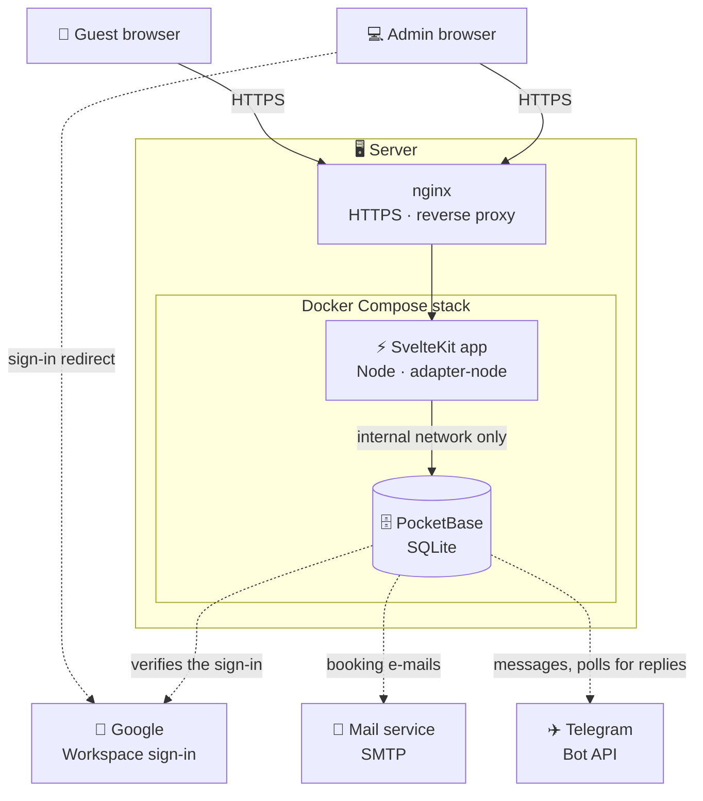
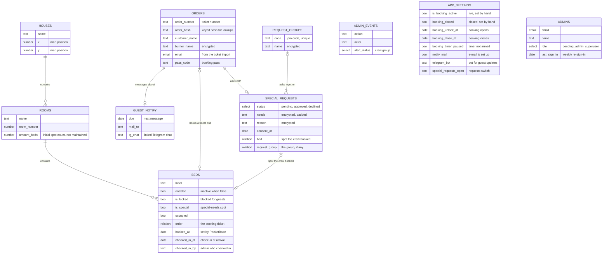
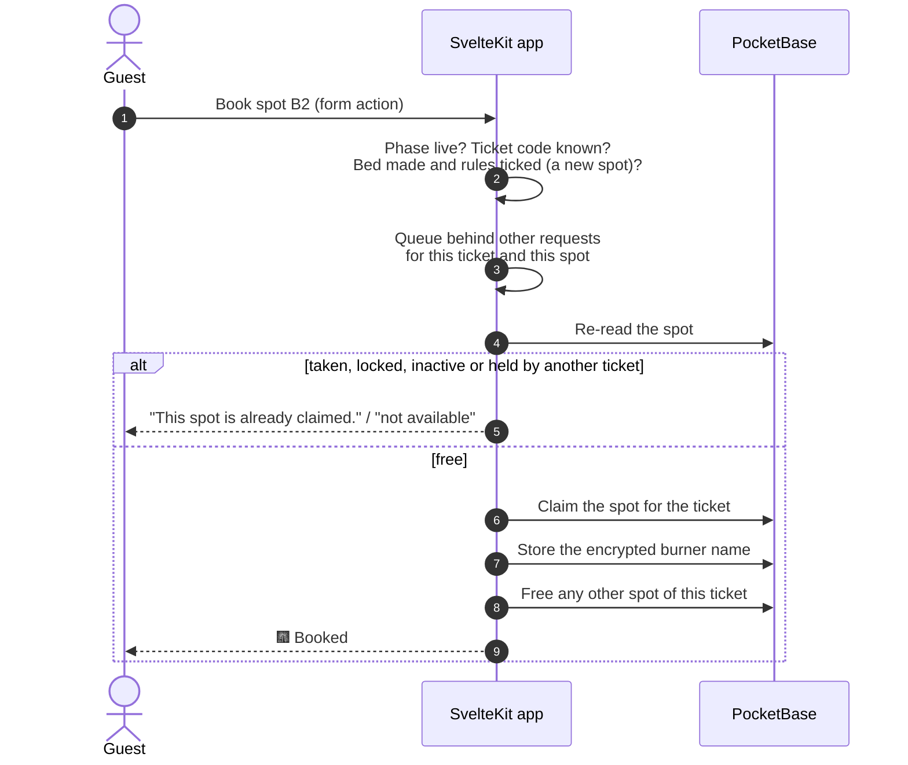

# Architecture

CozyNights is a server-rendered SvelteKit app in front of a PocketBase database, both running in Docker behind nginx.

## The big picture



- **Browsers only ever talk to the app.** Pages are rendered on the server, and every button submits a form to a server action. There is no public database API.
- **PocketBase is internal.** It is reachable from the app over the Docker network, and its dashboard only from the server itself.
- **nginx** terminates TLS and forwards the site's domain to the app, which listens on the server's loopback interface only.
- **PocketBase sends every message.** Booking e-mails go out through an SMTP service, Telegram messages through the Bot API. The bot fetches its incoming messages itself (long polling), so nothing on the server waits for calls from Telegram. See [Notifications](../admin/notifications).
- **The pass's QR code is drawn where the e-mail is made.** An e-mail that shows the spot carries the booking pass's QR code as a picture inside the e-mail. PocketBase draws it itself in `pb_hooks/lib/passqr.js`, with a copy of the app's `qr` library in `pb_hooks/lib/vendor/qr.js` that `npm run vendor:pb-qr` generates; `tests/pass-qr-hook.test.ts` keeps that copy at the installed version and the picture pixel for pixel the app's `/pass/:code/qr.png`. So no e-mail waits for the app or loads anything from the site, and if the picture fails, the e-mail goes out without it.

## Tech stack

| Layer | Technology |
| --- | --- |
| Web app | [SvelteKit 2](https://svelte.dev/docs/kit) with Svelte 5, TypeScript, Vite; [`adapter-node`](https://svelte.dev/docs/kit/adapter-node) |
| Styling | Tailwind CSS 4 plus component styles (the "laser" look), WebGL cursor trail and booking fireworks |
| Charts | Inline SVG and CSS — no charting library |
| Database & auth | [PocketBase](https://pocketbase.io) 0.40 (SQLite); schema and API rules as migrations, server hooks in JavaScript |
| Admin sign-in | Google OAuth 2.0 through PocketBase, limited to a Google Workspace domain |
| Hosting | Docker Compose, nginx with Let's Encrypt certificates |
| Tests | Vitest (unit and security), Playwright (end-to-end) |
| Docs | VitePress on GitHub Pages (this site) |

## Who reads and writes what

The app uses PocketBase in three different ways, each with its own rights:

| Context | Used for | Rights |
| --- | --- | --- |
| **Public** | Camp map, house and room pages | Read-only access to the layout: houses, rooms, spots and the phase settings. No personal data. |
| **Signed-in admin** | Control Center and editors | The admin's own session. PocketBase's API rules only accept layout changes from approved admins. |
| **App server** | Ticket codes, bookings, burner names | A privileged backend connection that only exists inside the app server. The ticket list has no public API access at all. |

Page data is trimmed on the server to what the page shows. A guest's room page, for example, gets spot labels, states and burner names, never other guests' tickets.

The app server's connection signs in as a service account and checks its token with PocketBase every five minutes. If PocketBase doesn't answer that check (a restart, a hiccup under load), the token is kept and checked again ten seconds later, so the app works again the moment PocketBase does. Only a token PocketBase turns down is dropped and replaced by a fresh sign-in. When the layout can't be read, the map says *The map could not be loaded right now. Please try again in a minute.*, never an empty camp that guests would read as sold out.

Every read the app sends to PocketBase gives up after 10 seconds, the service account's sign-in and token check after 5 (`src/lib/server/pocketbase.ts`). Writes never do: a booking or a release runs to the end. The same goes for admins: only PocketBase turning a session down ends it; when it doesn't answer, the admin stays signed in and only that request runs without admin rights. When the booking phase can't be read, the guest pages say the booking system is not reachable (for 30 seconds they show the last phase they read), guest actions change nothing and say so, and what unlocks something destructive — clearing the bookings, a template import, deleting a house, freeing a spot — refuses.

PocketBase saves the whole record on every update, so two writes of one record at the same moment would undo each other. Every write of a spot, a ticket or `app_settings` in the app therefore runs in that record's queue (`withLock` in `src/lib/server/booking.ts`: `bed:<id>`, `order:<id>`, `app_settings`), the queues guest bookings use too. Several are always taken in the same order — request group, ticket, spot (several spots sorted by id), `app_settings` last — so they never wait on each other in a circle. The queues live in the app's memory: they cover one app instance, not PocketBase's own hooks.

## Data model



- **`orders`** is the ticket list: one record per ticket. Guests' actions only write the burner name. Admins change e-mail addresses and names on the Tickets page, superusers add tickets from the ticket shop's list there. No admin action deletes orders.
- **Spots are called `beds`** in the database. A booking is simply a bed with `occupied` set and a link to its order; the crew's check-in at arrival adds `checked_in_at` and `checked_in_by`, which go with the booking.
- **`app_settings`** is a single record holding the phase set by hand and the booking window (opening and closing time, armed or paused).
- **`admins`** is its own auth collection for Google sign-in. PocketBase's default `users` collection is unused and closed for sign-up.
- **`guest_notify`** holds what each ticket was last told and where (e-mail, linked Telegram chat); **`admin_events`** is the audit log that feeds the crew group. Neither has API rules: only PocketBase itself and the app server use them.
- **`special_requests`** holds at most one special-needs request per ticket, for something the guest needs or for a project. What the guest ticked and wrote is encrypted by the app; the collection has no API rules. `bed` is the spot the crew booked for it, the only spot the guest can't change themselves. See [Special-needs requests](../admin/special-needs).
- **`request_groups`** links requests of guests who ask together: a join `code` and the encrypted `name`, nothing else. The group has no status; decisions and bookings live on each member's request. PocketBase deletes a group when its last request leaves it (`pb_hooks/cozy_groups.pb.js`). No API rules. See [Groups](../admin/special-needs#groups).
- **`message_texts`** holds the sentences admins changed on ✉️ Messages, one record per text (`key`, `text`, `updated_by`); the defaults are in `pb_hooks/lib/texts.js`, and PocketBase reads the records when it sends. No API rules. See [Message texts](../admin/notifications#message-texts).
- **`pass_code`** is created by PocketBase when a ticket gets a spot. It is not the ticket code: the pass shows the booking, never lets anyone book.
- Schema and API rules live in `hamburn-cozynights/pb_migrations/`. The migrations are idempotent, so a database restored from a backup is brought to the current rules too.

## Routes

| Route | Who | What |
| --- | --- | --- |
| `/` | everyone | Start page, ticket code sign-in |
| `/map` | everyone | Camp map, blurred with countdown in staging; read-only after booking closed |
| `/house/:id` | guests with a code | Rooms of a house with free spots |
| `/room/:id` | guests with a code | Spots of a room, booking dialog: a new spot first asks to make the bed and to tick the rules (`$lib/booking-check`) |
| `/random-bed` | guests with a code | Destiny Roulette, a slot machine for a random free spot; *Book it* opens the same check (make the bed, tick the rules); a guest with a spot sees it with the booking pass and can give it up with ✨ Leave No Trace (hold to sweep) and spin again |
| `/special-needs` | guests with a code | Ask for a special-needs spot or a project's room, start or join a request group (an invite link `?group=` fills in the code and survives the sign-in), see the crew's answer and the group's burner names, leave the group, withdraw |
| `/legal-notice` | everyone | Legal notice (Impressum), details from the server's `.env`; `/impressum` redirects here |
| `/privacy` | everyone | Privacy policy; `/datenschutz` redirects here |
| `/booking-rules` | everyone | Booking rules (bedding included), confirmed in every booking dialog |
| `/pass/:code` | whoever has the link | Booking pass with QR code (`/pass/:code/qr.gif` and `…/qr.png` as images); signed-in admins also see the booking, the check-in and a Check in button |
| `/telegram` | guests with a code | Updates on Telegram: connect the chat, see that it is on, turn it off. Confirmation e-mails link here |
| `/docs/*` | everyone | The guest guide and FAQ |
| `/admin/login` | everyone | Google sign-in and the *access requested* page |
| `/auth/callback/google` | – | Where Google sends admins back to |
| `/admin` | admins | Control Center: booking window, attention, latest bookings, Intel; the camp editor's and templates' form actions stay here (`/admin?/…`) |
| `/admin/camp` | admins | Map & houses: the map editor and the list of houses (`?view=list`), with each house's bookings |
| `/admin/templates` | admins | Burn Template Manager: export, compare, apply a layout file |
| `/admin/bookings` | admins | Who booked which spot (masked like at the check-in desk), filters, check-in and undo without the pass |
| `/admin/house/:id` | admins | Rooms of a house, and who is booked in it |
| `/admin/room/:id` | admins | Spots of a room, with the booking on each |
| `/admin/check` | admins | Check guests in with their booking pass (typed code, USB scanner or camera), undo a check-in |
| `/admin/requests` | admins | Special-needs requests and request groups: what became of the ♿ spots, read, approve or decline, book a spot (also while booking is closed) for one request or a whole group — picked in the spot picker, houses, rooms and spots to search and filter, a whole group into one room in one go — take a request out of its group, open or close requests |
| `/admin/messages` | admins | Message texts: every sentence guests get by e-mail, on Telegram and from the bot, with a preview of whole messages |
| `/admin/tickets` | admins | Find tickets, change their e-mail address, hand them over; superusers load the ticket list |
| `/admin/docs/*` | admins | The full documentation, admin pages included |
| `/admin/api/export-template` | admins | Layout template download |
| `/admin/api/stats` | admins | The live numbers (counts only), polled by the Control Center, the camp editor and the bookings list |
| `/admin/api/bookings` | admins | The booked spots with their guests, masked (`?house=` / `?room=`); fetched again only when the live numbers changed |
| `/api/health` | everyone | Readiness check for the deploy script and the smoke tests: 200 only while the app's service account is signed in to the database; the answer names the running `version` and `commit` |

A single server hook (`src/hooks.server.ts`) runs before every request. It restores the guest's ticket session and the admin session, re-checks the admin's role, and refuses admin form actions and API calls without an approved session, so no single action can forget the check.

## Booking, precisely



- **No double bookings.** Requests for the same ticket or the same spot run one after another, and availability is re-checked inside that queue. Two guests clicking the same bed at the same moment: exactly one wins.
- **One ticket, one spot.** Even parallel requests from the same ticket end with a single booked spot.
- **All or nothing.** Releasing the old spot, claiming the new one and writing the burner name are one PocketBase transaction (`POST /api/cozy/book`), which also checks the phase at the moment it writes. If anything fails, nothing changes: a guest never ends up with two spots, none, or a spot without its name. A unique index on `beds.order` is the database's own guard for "one ticket, one spot".
- **Every new spot comes with the check.** The booking window sends `rulesConfirmed` and `beddingConfirmed` with the booking: the guest made the bed and ticked the rules. Without both, the room page and the roulette refuse a new spot before touching it (*Before a spot is yours, make your bed…*); a new burner name for the spot the ticket holds needs neither, and so do the crew's bookings. Nothing about it is stored.
- **Ten-minute holds.** Opening the booking window, or the roulette landing on a spot, holds that spot for the ticket (`src/lib/server/spot-holds.ts`, taken in the same queue): one hold per ticket and per spot. A guest's booking of a spot another ticket holds is refused; the crew books past holds. A hold ends with a booking, when the window closes, at sign-out, after ten minutes, or when the crew releases all bookings, and the same ticket can't hold that spot again for another ten minutes. Open room pages ask `GET /room/<id>/holds` every 15 s (answered from memory, no database read) and reload when a hold ends early, which is usually a booking. Holds live in memory like the queue: a restart forgets them, and the spots are first come, first served again.
- **Single instance.** The queue lives in the app process, which matches the deployment of exactly one app container per environment. A second instance would lose the queue's order, but not the database's guarantees above.
- **A booking window without a scheduler.** The phase is *the one set by hand, unless the armed timer's opening or closing time has passed* (`src/lib/booking-phase.ts`). It is evaluated on every request, so nothing has to run at the opening or closing moment; open pages reload their data when their countdown ends. Admins enter the times in Europe/Berlin time. PocketBase's notification loop only *announces* a reached time to the crew group.

## Repository layout

```text
hamburn-cozynights/                 repository root
├── docs/                           this documentation site (VitePress)
├── .github/workflows/              staging deploy, docs deploy, release (a GitHub release per `v*` tag)
└── hamburn-cozynights/             the app
    ├── src/
    │   ├── hooks.server.ts         sessions and the admin gate for every request
    │   ├── routes/                 guest pages, /admin, OAuth callback
    │   └── lib/
    │       ├── components/         map, markers, slot machines, Leave No Trace spell, the booking check (make your bed, rules box), effigy title, admin widgets
    │       ├── fx/                 cursor trail, booking fireworks, burning effigy title, glitter sweep, roulette sounds
    │       └── server/             booking, inventory, settings, admin auth, crypto
    ├── pb_migrations/              database schema and API rules
    ├── pb_hooks/                   PocketBase hooks: admin sign-in guard, admin tool,
    │                               notifications, booking passes, backups; lib/passqr.js
    │                               draws the pass QR for e-mails with lib/vendor/qr.js
    │                               (generated by npm run vendor:pb-qr, never edited)
    ├── scripts/                    admin tool, health check, test setup, backups, release stamp
    ├── deploy/                     deploy script, nginx vhost, server runbook
    ├── tests/                      Vitest and Playwright tests
    ├── static/                     logo, site plan, background video
    ├── docker-compose.yml          local PocketBase
    └── docker-compose.staging.yml  staging stack
```
